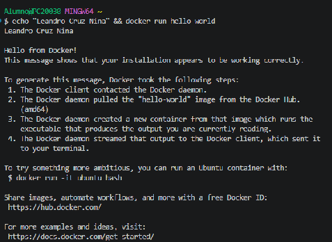
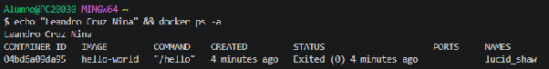
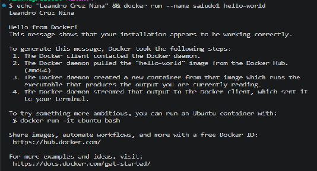
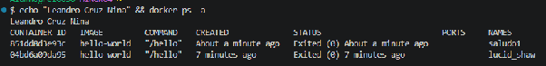
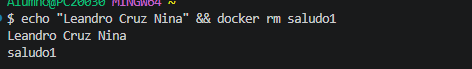
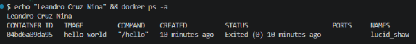
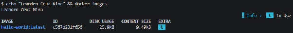
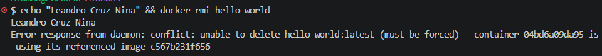
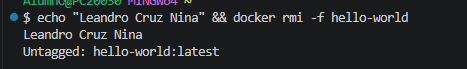
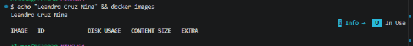

# **Contenedores Efímeros**

# 1: Ejecutar primer contenedor y observar ciclo de vida

## 1.1. Ejecución y Descarga

Comando ejecutado:  
echo "Leandro Cruz Nina" && docker run hello-world

  
Este comando busca la imagen hello-world localmente. Como no la encuentra, la descarga desde el registro oficial (Docker Hub), crea un contenedor a partir de ella, ejecuta su tarea predeterminada de mostrar un mensaje y se detiene automáticamente.

## 1.2. Reflexión y Documentación

**¿Qué mensaje aparece?**  
Aparece un mensaje de bienvenida de Docker que indica que la instalación funciona correctamente. También muestra los pasos que ha realizado Docker para descargar la imagen, crear el contenedor y ejecutar el programa.

**¿Dónde reside la imagen ahora? ¿Se ha eliminado después de la ejecución?**  
La imagen permanece almacenada localmente en el equipo. No se elimina cuando termina el contenedor, ya que las imágenes y los contenedores son elementos diferentes.

**¿Sigue "vivo" o terminó? ¿Cuál es el estado final de la tarea de este contenedor?**  
El contenedor termina su ejecución después de mostrar el mensaje de bienvenida. Su estado final es detenido Exited (0), lo que indica que finalizó correctamente. 

## 1.3. Verificación contenedor detenido

Comando ejecutado:  
echo "Leandro Cruz Nina" && docker ps \-a

  
El comando docker ps muestra únicamente contenedores en ejecución. Para listar los contenedores que han finalizado o están detenidos es necesario añadir el parámetro \-a.

El contenedor aparece listado con un CONTAINER ID único, asociado a la imagen hello-world y con un STATUS que indica Exited (0).   
Exited (0) significa que el proceso ya no se está ejecutando. 

# 2: Nombrar Contenedores para una mejor Gestión

## 2.1. Ejecutar con Nombre Personalizado

Comando ejecutado:  
echo "Leandro Cruz Nina" && docker run \--name saludo1 hello-world

El parámetro \--name saludo1 nos permite asignar un nombre personalizado al contenedor en lugar de utilizar el nombre aleatorio generado por Docker.

## 2.2. Verificación y Registro

Comando ejecutado:  
echo "Leandro Cruz Nina" && docker ps \-a

Comprobamos mediante la lista general de contenedores que el nuevo contenedor ha sido registrado bajo el nombre personalizado especificado.

## 2.3. Reflexión y Documentación

**¿Qué diferencias notas en la columna NAMES?**   
En la primera ejecución, Docker asignó automáticamente un nombre aleatorio al contenedor pero en la segunda ejecución, utilizamos el parámetro \--name para establecer el nombre personalizado saludo1.

**¿Por qué es útil asignar un nombre en lugar de depender del ID o del nombre aleatorio?**  
Nos facilita la identificación y administración de los contenedores, ya que permite reconocerlos fácilmente sin tener que recordar sus IDs o depender de nombres aleatorios.

# 3: Limpieza de Contenedores Detenidos

## 3.1. Eliminación por Nombre

Comando ejecutado:  
echo "Leandro Cruz Nina" && docker rm saludo1

El comando docker rm permite eliminar contenedores que se encuentran detenidos. Después de ejecutarlo, el contenedor deja de aparecer en el listado de contenedores del sistema.

## 3.2. Verificación de la Eliminación

Comando ejecutado:  
echo "Leandro Cruz Nina" && docker ps \-a

Verificamos que el contenedor saludo1 ha sido removido del registro de contenedores del sistema.

# 4: Limpieza de Imágenes

## 4.1. Listar Imágenes Locales

Comando ejecutado:  
echo "Leandro Cruz Nina" && docker images

  
Consultar el catálogo de imágenes descargadas en el almacenamiento local para verificar la presencia de hello-world.

## 4.2. Eliminación de la Imagen

Comando ejecutado:  
echo "Leandro Cruz Nina" && docker rmi hello-world  
  
nos sale un error ya que la imagen de referencia se encuentra en uso.  
  
echo "Leandro Cruz Nina" && docker rmi \-f hello-world, utilizamos el parámetro \-f para forzar la eliminación de la imagen.

.

## 4.3. Verificación Final

Comando ejecutado:  
echo "Leandro Cruz Nina" && docker images

Confirmamos que la imagen ya no figura en el catálogo de imágenes locales.

## 4.4. Reflexión y Documentación Final

**¿Cuál es la diferencia fundamental entre docker rm y docker rmi?¿Qué elimina cada uno?**  
Diferencia entre docker rm y docker rmi:  
docker rm elimina contenedores. docker rmi elimina imágenes (plantillas estáticas almacenadas en disco).

**¿Qué ocurriría si ahora intentaras ejecutar docker run hello-world de nuevo?**  
Docker detectará la ausencia de la imagen localmente, la descargará de nuevo desde Docker Hub y creará un nuevo contenedor para ejecutar la tarea.
